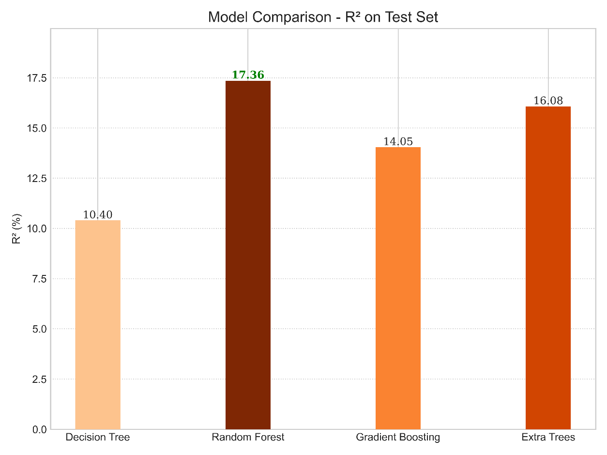
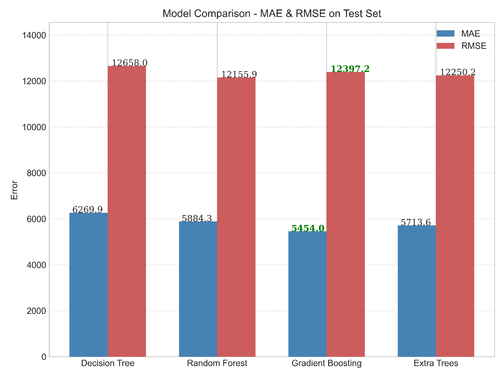
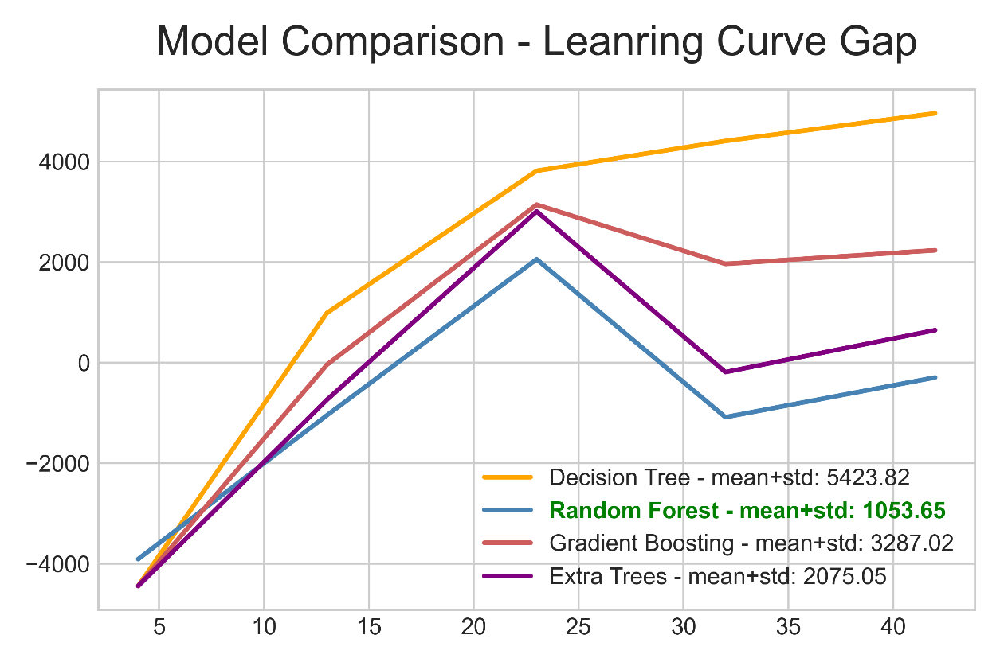

# AvandCenter Financial Forecasting Module

A machine learning component of the AvandCenter project for forecasting users' daily net balance based on historical transaction data.

This project focuses on designing a complete forecasting pipeline, including data processing, feature engineering, time-series validation, model evaluation, forecasting, and retraining strategies.

> **Note on results:** the module was trained and evaluated on **synthetic** transaction data, and the best model explains about **17% of the variance** in daily net balance on the test set (R² = 0.174). The emphasis of this project is a leakage-safe, time-aware evaluation framework and honest reporting of limitations, not a high headline score. See [Results](#results) and [Limitations](#limitations).

## Overview

Financial behavior is highly dynamic and difficult to predict due to irregular spending patterns, unexpected expenses, and limited historical information.

The goal of this project is to build a forecasting module capable of estimating future daily net balance:

**Net Balance = Income - Expense**

The system predicts the next seven days using a recursive multi-step forecasting strategy and evaluates different machine learning models to select the most reliable approach.

---

## Key Features

- Time-series based financial forecasting
- Leakage-safe feature engineering pipeline
- Calendar and historical transaction features
- Time-aware model validation using `TimeSeriesSplit`
- Hyperparameter optimization using `RandomizedSearchCV`
- Comparison of multiple regression models
- Recursive 7-day forecasting engine
- Automated retraining strategy
- Modular system architecture

---

## System Architecture

The project follows a modular architecture where each component has a specific responsibility.

```
Financial Transactions
          |
          v
User Eligibility Checking
          |
          v
Feature Engineering
          |
          v
Preprocessing Pipeline
          |
          v
Model Training & Optimization
          |
          v
Forecasting Engine
          |
          v
7-Day Net Balance Prediction
          |
          v
Retraining Manager
```

---

## Project Structure

```
AvandCenter-Financial-Forecasting-Module/
│
├── Eligibility/
│   └── eligibility.py
│
├── Feature_Engineering/
│   ├── EDA.py
│   ├── pipelines.py
│   └── x_y_creation.py
│
├── Training/
│   └── model_opt.py
│
├── Prediction/
│   └── predict.py
│
├── Retraining/
│   └── retrain.py
│
├── Documentation/
│   └── Technical_Documentation.pdf
│
├── figures/                  # Plots from the technical documentation
├── data/                     # Synthetic transaction data (see "Data" below)
├── requirements.txt
├── LICENSE
└── README.md
```

---

## Data

The module was developed on a **synthetic** dataset of daily user transactions, generated to mimic everyday purchases, recurring payments (such as rent), and random financial events. No real user data is used or included in this repository.

The data file is in `data/`. Statistical analysis (distribution, autocorrelation, variability) suggests it is a reasonable approximation of real behavior, but it cannot fully reproduce it. See [Limitations](#limitations).

---

## Installation

```bash
git clone https://github.com/alikhajouei2006/AvandCenter-Financial-Forecasting-Module
cd AvandCenter-Financial-Forecasting-Module
pip install -r requirements.txt
```

---

## Module Overview

The repository is organized as modules rather than a single command-line script. Each file has one responsibility:

| Step | File                                  | Responsibility                                                                                                  |
| ---- | ------------------------------------- | --------------------------------------------------------------------------------------------------------------- |
| 1    | `Eligibility/eligibility.py`          | Checks that a user has enough history to be forecast (minimum 14 days of activity and 20 recorded transactions) |
| 2    | `Feature_Engineering/EDA.py`          | Builds calendar and lag/rolling features                                                                        |
| 3    | `Feature_Engineering/pipelines.py`    | Preprocessing pipeline (date features, lag features, scaling)                                                   |
| 4    | `Feature_Engineering/x_y_creation.py` | Generates the feature matrix `X` and target `y`                                                                 |
| 5    | `Training/model_opt.py`               | Hyperparameter search and model training                                                                        |
| 6    | `Prediction/predict.py`               | Recursive 7-day forecasting engine                                                                              |
| 7    | `Retraining/retrain.py`               | Decides when to retrain (see [Retraining Strategy](#retraining-strategy))                                       |

For design details and the reasoning behind each decision, see `Documentation/Technical_Documentation.pdf`.

---

## Feature Engineering

The model uses both calendar-based and historical features.

### Calendar Features

| Feature     | Description                           |
| ----------- | ------------------------------------- |
| DayOfWeek   | Captures weekly patterns              |
| IsWeekend   | Identifies weekend behavior           |
| DayOfMonth  | Captures monthly recurring events     |
| Month       | Captures seasonal patterns            |
| WeekOfMonth | Captures within-month weekly patterns |

### Lag Features

| Feature              | Description                         |
| -------------------- | ----------------------------------- |
| NetBalance_lag1      | Previous day's net balance          |
| NetBalance_lag7      | Net balance from seven days earlier |
| NetBalance_rollmean7 | 7-day rolling average               |
| NetBalance_rollstd7  | 7-day rolling standard deviation    |

The preprocessing pipeline ensures that feature generation and scaling are performed without future information leakage.

---

## Models Evaluated

The following regression models were evaluated:

- Linear Regression
- Ridge Regression
- Lasso Regression
- Decision Tree
- Random Forest
- Gradient Boosting
- Extra Trees

Linear models (Linear, Ridge, Lasso) were used as baselines; the four tree-based models (Decision Tree, Random Forest, Gradient Boosting, Extra Trees) were then tuned and compared.

Models were evaluated using:

- R²
- MAE
- RMSE
- Cross-validation standard deviation
- Learning curve analysis

---

## Validation Strategy

Because financial data is time-dependent, standard random cross-validation is not suitable.

The project uses:

```
TimeSeriesSplit
n_splits = 5
```

This approach preserves chronological order and prevents future information from being used during training.

Hyperparameter optimization was performed using:

```
RandomizedSearchCV
n_iter = 25
scoring = neg_RMSE
```

---

## Results

All numbers below are on the held-out test set (or from time-series cross-validation) with **synthetic data**.

**Baseline (linear) models** — all performed poorly, indicating the relationship is not linear:

| Model             | R² Train | R² Test | MAE Test | RMSE Test |
| ----------------- | -------- | ------- | -------- | --------- |
| Linear Regression | 0.1375   | 0.0339  | 7521.98  | 13143.27  |
| Ridge             | 0.1375   | 0.0350  | 7511.33  | 13136.27  |
| Lasso             | 0.1375   | 0.0340  | 7521.49  | 13142.98  |

**Tuned tree-based models:**

| Metric             | Decision Tree | Random Forest | Gradient Boosting | Extra Trees |
| ------------------ | ------------- | ------------- | ----------------- | ----------- |
| R² (test, %)       | 10.40         | **17.36**     | 14.05             | 16.08       |
| MAE (test)         | 6269.9        | 5884.3        | **5454.0**        | 5713.6      |
| RMSE (test)        | 12658.0       | **12155.9**   | 12397.2           | 12250.2     |
| CV RMSE std        | 2674.31       | **1564.51**   | **1564.51**       | 1627.66     |
| Learning-curve gap | 5423.82       | **1053.65**   | 3287.02           | 2075.05     |
| CV RMSE mean       | 13159.5       | 12743.4       | 12715.8           | **12579.8** |

(Best value in each row in bold; ties are bolded for both.)

**How to read these results:** the best model explains roughly 17% of the variance in daily net balance. This is expected for this data: the autocorrelation of net balance is weak (only lag 1 is slightly significant), and the series is dominated by rare large spikes (salary, rent) of up to ±60,000 units, which keep RMSE high. Linear models perform far worse than tree-based models.

<p align="center">
  
  
  
</p>

Additional exploratory figures (net-balance time series, histogram, autocorrelation, learning curves, cross-validation variability) are in [`figures/`](figures/) and in the technical documentation.

---

## Final Model Selection

Random Forest was selected as the final forecasting model. The selection criterion was to minimize the sum of the **learning-curve gap** and the **cross-validation standard deviation**, which considers overfitting and stability together.

Reasons:

- Highest test-set R² among evaluated models (17.36%)
- Lowest test-set RMSE
- Smallest learning-curve gap (1053.65), i.e., lowest degree of overfitting
- Low cross-validation variability (std 1564.51, tied with Gradient Boosting)
- Fast training and inference, which suits periodic retraining

Gradient Boosting achieved a slightly better MAE, and Extra Trees the best mean CV RMSE, but Random Forest gave the best balance between accuracy and stability.

---

## Forecasting Strategy

The forecasting engine uses a recursive multi-step approach.

Example:

```
Day t historical data
        |
        v
Predict Day t+1
        |
        v
Use prediction as input
        |
        v
Predict Day t+2
        |
        ...
        |
        v
Predict Day t+7
```

The final output contains:

- Seven predicted daily net balances
- Sum of predicted values

A known limitation of recursive forecasting is error propagation, where prediction errors may accumulate over longer forecast horizons.

---

## Retraining Strategy

The model is retrained only when sufficient new information becomes available.

Retraining conditions:

| Condition        | Threshold                               |
| ---------------- | --------------------------------------- |
| New Transactions | At least 10 new transactions            |
| Time Interval    | At least 7 days since previous training |

This prevents unnecessary retraining while allowing the model to adapt to new financial behavior.

---

## Limitations

### Limited Feature Space

The model relies mainly on transaction history and calendar information.

External variables such as:

- Inflation rate
- Holiday events
- Salary cycles

are not included.

### Synthetic Dataset

The model was trained and evaluated using synthetic financial data.

Although statistical analysis suggests that the generated data captures realistic patterns, real-world performance requires validation using actual user transaction data.

### Limited Data for New Users

Newly eligible users have only the minimum activity (14 days and 20 transactions), so early forecasts are expected to be less reliable. Performance should improve as more history accumulates and the model is retrained.

### Financial Behavior Uncertainty

Human financial behavior contains unpredictable events such as unexpected expenses and irregular purchases.

Weak temporal correlation in the data limits the achievable forecasting accuracy.

### Recursive Forecasting Error

Prediction errors may accumulate across multiple forecasting steps, reducing accuracy for later forecast horizons.

---

## Technologies Used

- Python
- pandas
- NumPy
- scikit-learn
- Matplotlib
- Machine Learning Regression Models

---

## Documentation

A complete technical documentation file is available:

```
Documentation/Technical_Documentation.pdf
```

The documentation includes:

- Dataset analysis and exploratory data analysis (time series, histogram, ACF)
- Feature engineering details
- Model evaluation (baselines, learning curves, test-set and CV comparison)
- Forecasting methodology
- Retraining strategy
- System limitations

---

## Future Improvements

Potential improvements include:

- Training on real user transaction data
- Adding external economic features
- Exploring advanced time-series models
- Incorporating user-specific behavior modeling
- Improving uncertainty estimation for predictions
